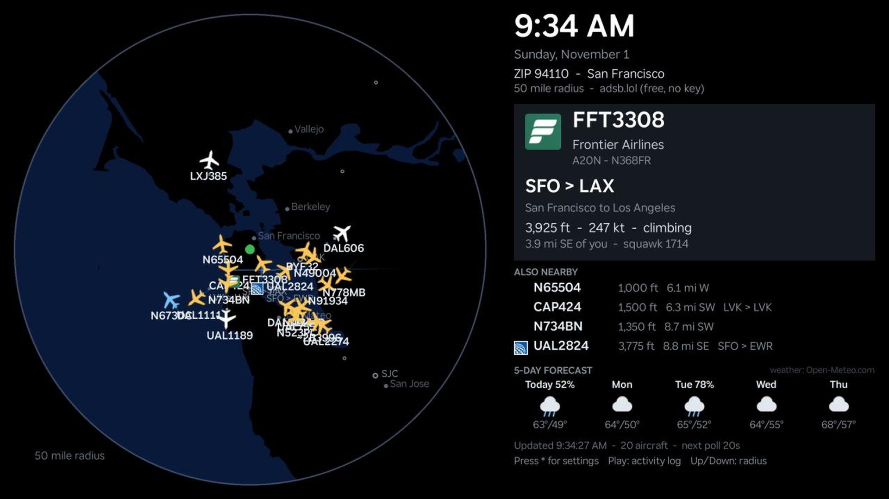
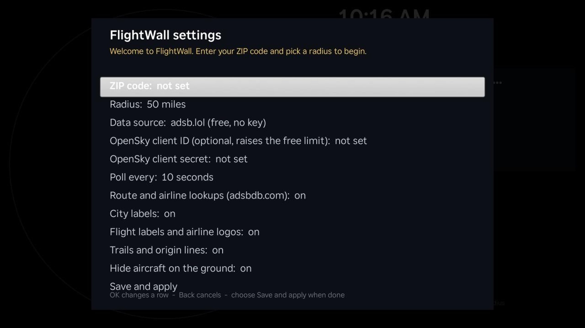

# FlightWall for Roku

A Roku channel **and screensaver** that shows the aircraft flying around your home on a
minimal dark map, inspired by [OpenFlightWall](https://github.com/dilshanonline/OpenFlightWall)
and [TheFlightWall](https://github.com/AxisNimble/TheFlightWall_OSS).



| Nearest flight, routes and logos | Settings screen (first run) |
|---|---|
|  |  |

- **Minimal map built for older sticks**: land is black, water is dark blue, with major
  airports and city labels for orientation. The map is pre-rendered into small tiles at
  build time, so the Roku only places a few images instead of drawing geometry.
- **Live aircraft** with altitude-tinted plane icons, callsign, airline logo, origin and
  destination, a breadcrumb trail, and a line pointing back toward where the flight came from.
- **ZIP code + radius** entered on the TV with the remote (10 to 250 miles).
- **Polling every 10 s by default** (10/15/20/30/60 s), with exponential back-off when a
  data source pushes back.
- **API-key entry surfaced in the UI**: when a free source answers HTTP 429 twice in a row,
  the settings screen opens on the data-source row so you can switch sources or add free
  OpenSky credentials for a higher daily limit. Credentials are typed on the Roku keyboard
  and stored only in the device registry.
- **Screensaver mode**: the same scene runs as a Roku screensaver (Settings > Theme >
  Screensavers), with its own "Change screensaver settings" screen.
- **Five-day forecast** for the same ZIP code along the bottom of the panel (Open-Meteo,
  refreshed hourly).
- **Activity log** (press Play): every poll, error and settings change, kept in a registry
  section separate from the settings themselves.

Everything is keyless and free by default. Data sources:

| What | Source | Notes |
|---|---|---|
| Aircraft positions | [adsb.lol](https://api.adsb.lol/docs) (default), [adsb.fi](https://github.com/adsbfi/opendata), [OpenSky Network](https://openskynetwork.github.io/opensky-api/) | OpenSky anonymous access is ~400 credits/day; a free account (OAuth2 client credentials) raises it to 4000+ |
| Routes and airlines | [adsbdb.com](https://www.adsbdb.com/) | At most 3 new callsign lookups per poll, cached for the session |
| Airline logos | `images.kiwi.com/airlines/64/{IATA}.png` | Same public CDN OpenFlightWall uses |
| Five-day forecast | [Open-Meteo](https://open-meteo.com/) | Free, keyless; refreshed hourly; attribution shown on screen |
| Coastlines, lakes, cities | [Natural Earth](https://www.naturalearthdata.com/) 1:10m (public domain) | Rasterized into 1-degree tiles |
| Airports | [OurAirports](https://ourairports.com/data/) (public domain) | US large and medium airports |
| ZIP centroids | [US Census ZCTA gazetteer 2023](https://www.census.gov/geo/maps-data/data/gazetteer-files.html) | Bundled, looked up offline on the device |

## Requirements

- Windows, macOS or Linux with [uv](https://docs.astral.sh/uv/) installed (it manages Python 3.12 for you), **or** Docker.
- A Roku in developer mode on your LAN. Enable it with the remote: Home ×3, Up ×2, Right, Left, Right, Left, Right. Note the IP address and set a developer password. Roku's guide: <https://developer.roku.com/docs/developer-program/getting-started/developer-setup.md>
- No other tooling is required. Roku provides no desktop emulator; the channel runs only on a device. The only Roku-published dependency is the [Roku Unit Testing Framework](https://gitlab.com/rokudev/unit-testing-framework), vendored under `roku/source/testFramework/` for the on-device tests (it is excluded from release packages).

## Install and start

```bash
cd roku-flightwall
uv sync                       # creates .venv with Pillow + dev tools
uv run flightwall all         # downloads map/zip/airport data, builds tiles and artwork,
                              # runs static checks, writes dist/flightwall.zip and
                              # dist/flightwall-screensaver.zip
```

The generated data and artwork are already checked in under `roku/data` and `roku/images`,
so `uv run flightwall package` alone is enough if you only changed BrightScript.

### Side-load onto the Roku

Review the code first if you like (`roku/` is the whole channel), then:

```bash
cp .env.example .env            # then fill in ROKU_HOST and ROKU_DEV_PASSWORD
uv run flightwall deploy
```

The CLI reads `.env` from the project root (it is git-ignored). Flags override it, so
`uv run flightwall deploy --host <roku-ip> --password <pw>` works without a `.env`, as does
setting `ROKU_DEV_PASSWORD` in the environment.

`deploy` runs the static checks, zips `roku/`, and posts the package to the Roku's
Development Application Installer (HTTP digest auth, user `rokudev`). The channel launches
automatically. You can also upload `dist/flightwall.zip` by hand at `http://<roku-ip>/`.

To remove it later: `uv run flightwall delete --host <roku-ip>`.

### First run

1. The settings screen opens. Press OK on **ZIP code**, type it on the keyboard, OK.
2. Press OK on **Radius** to cycle through 10/25/50/75/100/150/200/250 miles.
3. Choose **Save and apply**. The ZIP is resolved to coordinates from the bundled table and polling starts.

You can also set the ZIP and radius from your PC through the Roku's External Control
Protocol, which saves them exactly as if typed on the TV:

```bash
curl -d "" "http://<roku-ip>:8060/launch/dev?zip=94110&radius=50&poll=20"
```

(`poll` is the refresh interval in seconds, 5 to 600; all three parameters are optional.)

To see what the TV is showing without walking over: `uv run flightwall screenshot --host <ip>`
writes `dist/screenshot.jpg` using the installer's screenshot utility.

Settings also include the data source, OpenSky credentials, poll interval, route lookups,
city labels, flight labels and logos, trails and origin lines, and **Hide aircraft on the
ground** (on by default; taxiing traffic otherwise piles up on airports).

Remote keys on the main screen:

| Key | Action |
|---|---|
| `*` or OK | Settings |
| Up / Down | Radius up / down |
| Play | Activity log on/off |
| Back | Exit |

### Use it as the screensaver

Roku requires a screensaver package to have no `Main()` entry point, so a screensaver-only
build is produced alongside the channel. The two share the same code and the same settings.

1. Side-load the combined build first (`flightwall deploy`) and set your ZIP and radius.
2. Side-load the screensaver build: `uv run flightwall deploy --host <ip> --screensaver-only`
   (a Roku holds one side-loaded app at a time; this replaces the channel build).
3. On the Roku: **Settings > Theme > Screensavers**, pick **FlightWall**. "Change screensaver
   settings" opens the same settings screen, so ZIP, radius, source and credentials can also be
   changed from there.
4. Set the wait time under Settings > Theme > Screensavers > Wait time.

If your Roku lists FlightWall under Screensavers while the combined build is installed, you can
skip step 2 and keep the channel and screensaver in one package.

## Running it all day: screensaver vs. channel

Roku OS exits any channel that has had no remote-control input for two hours
(`EXIT_IDLE_AUTO_EXIT` in the debug console). There is no setting to disable it and FlightWall
does not try to trick it. For an always-on wall display, make FlightWall the **screensaver**:
the OS starts it itself after the idle wait time and keeps it up until a button is pressed.
Use the channel for setup and for watching interactively.

### If your receiver shows a blue screen (HDMI handshake)

A SceneGraph app cannot renegotiate HDMI; the link drops when the Roku changes output mode or
loses power. Things that help, in order:

1. **Power the stick from its wall adapter**, not a USB port on the receiver or TV. Marginal
   USB power is the most common cause of intermittent blank screens on sticks, and every poll
   is a Wi-Fi plus TLS burst that briefly raises the stick's power draw. FlightWall now reuses
   its HTTPS connections between polls, redraws only what changed, and updates the clock once a
   minute instead of once a second, so its duty cycle is low, but it cannot fix a power supply.
2. **Settings > System > Power > Auto power savings: off.** Otherwise the stick sleeps after a
   few idle hours, drops HDMI, and has to handshake again when it wakes.
3. **Settings > Display type: 1080p** (fixed) and **Settings > System > Advanced system settings
   > Auto-adjust display refresh rate: off**, so nothing ever changes the output mode.
4. On the receiver, turn HDMI Control (CEC) off for that input and set its HDMI signal format
   to standard (non-enhanced) for a 1080p source.

## When a free source rate-limits you

- adsb.lol and adsb.fi apply dynamic, unpublished limits; one query every 10 seconds has been
  fine in testing. On HTTP 429 the app doubles the interval (20, 40, 80 ... up to 300 s) and
  shows a banner; after the second 429 the settings screen opens on **Data source**.
- OpenSky without credentials gives about 400 credits a day (one 10-second poll burns a credit),
  so it is best used with a free account:
  1. Register at <https://opensky-network.org/>, open your account page, create an **API client**.
  2. In FlightWall settings enter the **OpenSky client ID** and **client secret**, choose
     **OpenSky Network** as the data source, Save.
  The app fetches an OAuth2 token, refreshes it before it expires, and shows the remaining
  daily credits in the status line.

## Developing

```bash
uv run pytest                 # Python tooling tests, 100% branch coverage enforced
uv run ruff check . && uv run ruff format --check . && uv run mypy
uv run flightwall check       # BrightScript/SceneGraph static checks (block balance,
                              # terminators, script and pkg:/ references, manifest)
uv run flightwall run-tests --host <roku-ip>   # on-device unit tests via Roku's framework
```

`run-tests` side-loads `dist/flightwall-tests.zip`, launches it with `RunTests=true`, captures the
BrightScript console on port 8085 and exits non-zero on any failure. The same console
(`telnet <roku-ip> 8085`) shows runtime errors from the channel itself.

### Layout

```
roku/                      The channel (zip this directory = the package)
  manifest
  source/main.brs          Main() entry point (omitted from the screensaver build)
  source/screensaver.brs   RunScreenSaver() and RunScreenSaverSettings()
  source/lib/*.brs         Pure helpers shared by every thread: geo, flights, routes, settings...
  source/tests/            On-device unit tests (test build only)
  source/testFramework/    Roku Unit Testing Framework (test build only)
  components/              SceneGraph: MainScene, MapView, InfoPanel, SettingsPanel,
                           DiagnosticsPanel, FlightTask (network), LookupTask (ZIP), SettingsScene
  images/tiles/            1-degree land/water tiles + index.json (generated)
  images/planes/           36 pre-rotated plane sprites (generated)
  data/                    zips.txt, airports.json, cities.json (generated)
tools/flightwall_tools/    Python CLI: build-data, images, check, package, deploy, run-tests, screenshot, delete
tests/                     pytest suite for the tooling
```

### Docker

```bash
docker build -t flightwall-tools .
docker run --rm -v "$PWD:/work" flightwall-tools all
docker run --rm -v "$PWD:/work" -e ROKU_DEV_PASSWORD flightwall-tools deploy --host <roku-ip>
```

## Security and compliance notes

- **No server, no database, no telemetry.** The Roku talks directly to the public APIs above
  over HTTPS. Nothing is sent anywhere else, and the tooling never phones home.
- **Secrets**: the developer password is read from `--password`, `ROKU_DEV_PASSWORD` or an
  interactive prompt and is never written to disk. OpenSky credentials live only in the Roku's
  per-channel registry (`flightwall` section) and are entered on the TV.
- **Audit trail**: API calls (time, source, HTTP status, aircraft count, latency), ZIP lookups
  and settings changes are appended to a ring buffer in a separate registry section
  (`flightwall_audit`), viewable on screen with Play. The device identity is logged at start.
- **Access control**: a sideloaded channel is only installable with the Roku developer password;
  there are no user accounts in the app itself. RBAC and SSO do not apply to a single-user TV
  screensaver and were deliberately not added.
- **Supply chain**: the only third-party code on the device is Roku's own unit-testing framework
  (test build only). Python dependencies are pinned in `uv.lock`.

## Support

End-user setup and troubleshooting live in [store/SUPPORT.md](store/SUPPORT.md). Support email:
<mranonymous2000@yahoo.com>.

## Publishing to the Roku Channel Store

Everything needed for a submission lives under `store/`: the listing text, a privacy policy,
FHD screenshots and a step-by-step guide (`store/SUBMISSION.md`). The tooling can generate the
device signing key and produce the signed package:

```bash
uv run flightwall genkey                                  # once; save the password in .env
uv run flightwall deploy --screensaver-only               # screensaver build: no Main()
uv run flightwall sign                                    # -> dist/flightwall-screensaver.pkg
uv run flightwall deploy --channel-only                   # channel build: no screensaver code
uv run flightwall sign --out dist/flightwall-channel.pkg  # -> dist/flightwall-channel.pkg
```

Roku treats channels and screensavers as separate app types, each its own Channel Store listing
with its own package, and its static analysis rejects a package that mixes them. The type is
read from the manifest: a screensaver has `screensaver_title` and no `title`. Submit each type
from its own build; the default (combined) build is for local side-loading only.

The signed `.pkg` lands in `dist/`. Upload that file, not the `.zip` (the dashboard rejects
zips as "incorrectly packaged"); the zips are for side-loading only. Filling in the listing and
passing Roku's certification review happen in the Roku Developer Dashboard under your own account.

## Credits and licenses

FlightWall is released under the [MIT License](LICENSE). It was written from scratch for Roku,
but its design follows two open-source projects, both licensed under the Apache License 2.0:

- **[OpenFlightWall](https://github.com/dilshanonline/OpenFlightWall)** by Dilshan Wijesooriya.
  The keyless data-source selection (OpenSky and adsbdb), the free-bucket-first approach to
  optional OpenSky credentials, the nearest-flight hero card, the always-on "wall mode" idea and
  the airline-logo CDN all come from studying its code. No code was copied.
- **[TheFlightWall](https://github.com/AxisNimble/TheFlightWall_OSS)** by AxisNimble, the LED
  flight wall that inspired OpenFlightWall in turn.

Bundled third-party code: the
[Roku Unit Testing Framework](https://gitlab.com/rokudev/unit-testing-framework),
Copyright 2016 Roku, Inc., Apache License 2.0 (`roku/source/testFramework/`, test builds only).

Data and services, with their terms:

| Source | License / terms |
|---|---|
| [Natural Earth](https://www.naturalearthdata.com/about/terms-of-use/) coastlines, lakes, cities | Public domain |
| [OurAirports](https://ourairports.com/data/) airports | Public domain |
| [US Census Bureau](https://www.census.gov/geo/maps-data/data/gazetteer-files.html) ZIP centroids | US government work, public domain |
| [adsb.lol](https://github.com/adsblol/api), [adsb.fi](https://github.com/adsbfi/opendata) aircraft positions | Community-run, free, dynamic rate limits |
| [OpenSky Network](https://opensky-network.org/about/terms-of-use) aircraft positions | Free for non-commercial use under OpenSky's terms |
| [adsbdb.com](https://www.adsbdb.com/) routes and airlines | Community-run, free |
| [Open-Meteo](https://open-meteo.com/en/terms) forecasts | CC BY 4.0; attribution shown on screen |
| Airline logos via `images.kiwi.com` | Public CDN; logos remain trademarks of their airlines |

## Troubleshooting

- **"Install Failure" on deploy**: the Roku prints the compile error in its web installer and on
  the console (`telnet <ip> 8085`). Run `uv run flightwall check` for the static checks first.
- **Blank map (no coastlines)**: the ZIP is outside the tiled regions (CONUS + Hawaii by default).
  Build Alaska too with `uv run flightwall build-data --regions conus,hawaii,alaska`.
- **No aircraft**: increase the radius, check the status line for the HTTP status, or try another
  data source. Routes may read "Route unavailable" for private, military and GA flights.
- **Planes do not point the right way**: tracks are rounded to 10-degree sprites on purpose; it
  keeps the renderer trivial for older hardware.
